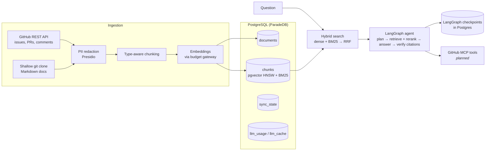

# Dev Docs Copilot: Agentic RAG over a codebase

An onboarding assistant that answers engineers' questions about a codebase using its **docs, issues, pull requests, and review discussions**. Every claim is cited, and the assistant can take GitHub actions after a human approves them.

> *"Why did they switch sessions from Redis to Postgres?"*
> *"Is there an open bug about background tasks, and has anyone tried fixing it?"*
> *"How do I configure request timeouts?"*

### Why RAG?

In real use this runs against a company's **private** repositories, which no LLM was trained on, and the content changes every day. The portfolio demo indexes a public repo only because private data can't be shown. The evaluation suite (planned) measures the benefit directly by comparing answers **with and without retrieval** on the same questions.

---

## Architecture



**Everything lives in one PostgreSQL database**: documents, chunks with vector embeddings (pgvector), a BM25 keyword index (ParadeDB `pg_search`), sync checkpoints, and an LLM cost ledger. One database means fewer moving parts to run and keep consistent.

## What's built so far

| Component | Highlights |
|---|---|
| **Ingestion** | GitHub issues and PRs (with comments and review comments) plus Markdown docs from a shallow clone. **Incremental sync** with GitHub's `since` parameter, and a checkpoint that only advances after a fully successful pass. |
| **PII redaction** | Presidio removes emails, phone numbers, card numbers, SSNs, IP addresses, and leaked API tokens (`ghp_…`, `sk-…`, `AKIA…`) **before** embedding, so the vector index never contains PII. |
| **Chunking** | Docs are split at headings (and ignore `#` lines inside code blocks). Issue and PR threads are kept whole when they fit; when split, each piece repeats the `#123 Title` header so it still makes sense alone. Token-bounded with tiktoken. |
| **Idempotent pipeline** | Content hashing skips re-embedding unchanged text (a re-sync costs $0) while still refreshing metadata such as an issue being closed. Each document is written in its own transaction. Docs deleted from the repo are removed from the index. |
| **Hybrid search** | Dense (cosine similarity, HNSW), sparse (BM25), and **Reciprocal Rank Fusion**, with parameterized filters by type, state, and date. Safe on arbitrary user input. |
| **Budget gateway** | The only module that calls OpenAI. It caches responses, records the cost of every call, retries with exponential backoff and jitter, and **refuses to call once a spend ceiling is reached**. |

## The agent

```
question ─► plan ─► retrieve ─► synthesize ─► verify ─► respond
           (nano)   hybrid +     (mini)        │  every [chunk_id] must point at a
                    rerank          ▲          │  retrieved chunk: one self-correction,
                                    └──retry───┘  then invalid citations are stripped
        state checkpointed in Postgres after every step (threads survive restarts)
```

- **Query decomposition:** a cheap model splits the question into 1–3 self-contained searches with optional filters (issues only, open, merged…). It rewrites follow-ups ("what about in PRs?") into standalone searches using the conversation history.
- **Two-stage retrieval:** hybrid search fetches 10 candidates per sub-query, then a local **cross-encoder** (ONNX, CPU, about 40 ms for 30 chunks) reranks each against *its own* sub-query and keeps up to 4 that score above a calibrated cutoff.
- **Grounded answers:** structured output `{answer, cited_chunk_ids, insufficient_context}`. Retrieved text is fenced as data (`<chunk id=… state=… author=…>`). If nothing is found, a fixed reply is returned with no LLM call.
- **Durable and cheap:** LangGraph `PostgresSaver` checkpoints, `RetryPolicy` only for malformed model output (never for `BudgetExceeded`), and every LLM call goes through the budget gateway and its cache.

```bash
uv run copilot ask "How do I run code when the application starts up and shuts down?"
uv run copilot ask "Has that change been merged, and who made it?" --thread <id>   # follow-up
```

**First real runs:** [findings](docs/results/2026-10-19-findings.md), with full per-question reports listing every candidate chunk and its reranker score.

| | |
|---|---|
| Cost per new question | **about $0.001** (repeat: $0.000) |
| Latency | 2–5 s new, under 1 s cached |
| Reranker cutoff | −1.0, chosen from the score gap between relevant (≥ −0.5) and irrelevant (≤ −1.14) chunks |
| Notable fix | The model claimed a closed PR was "merged" because it never saw PR state. State and author now go into the context, and the answer is correct. |
| Known open issue | Prompting doesn't remove every status error (one "closed but merged" contradiction). Claim-level verification comes in plan 5. |

## Roadmap

- [x] **Plan 1: Foundation.** Storage, ingestion, PII redaction, chunking, hybrid search, CLI, first real index
- [x] **Plan 2: Agent.** LangGraph planner (query decomposition), cross-encoder reranking, Postgres checkpointing, retries, cited answers with self-correction
- [ ] **Plan 3: Tools and human-in-the-loop.** GitHub MCP tools, approval-gated write actions, FastAPI and a chat UI
- [ ] **Plan 4: Observability and evals.** OpenTelemetry/OpenInference traces in Arize Phoenix, cost and latency per request, DeepEval golden set, GitHub Actions quality gate, retrieval experiments
- [ ] **Plan 5: Guardrails.** Prompt-injection detection (including in retrieved content), citation verification, role-based action authorization

Design document: [`docs/superpowers/specs/2026-10-18-dev-docs-copilot-design.md`](docs/superpowers/specs/2026-10-18-dev-docs-copilot-design.md)

## Tech stack

Python 3.12 · uv · LangGraph (+ Postgres checkpointer) · PostgreSQL 18 (ParadeDB: pgvector + pg_search) · psycopg 3 · OpenAI (`text-embedding-3-small`, `gpt-4.1-nano`, `gpt-4.1-mini`, structured outputs) · fastembed cross-encoder (ONNX) · Presidio + spaCy · tiktoken · httpx · pydantic · Typer · pytest + respx · Docker Compose
*Planned:* MCP · FastAPI · OpenTelemetry · Arize Phoenix · DeepEval · GitHub Actions

## Getting started

```bash
# 1. Start Postgres (ParadeDB with pgvector + pg_search)
docker compose up -d --wait db

# 2. Create the virtualenv and install dependencies
uv venv --python 3.12
uv sync

# 3. Configure
cp .env.example .env      # add your OpenAI key and a read-only GitHub token

# 4. Run the test suite (uses a separate copilot_test database; no network calls)
uv run pytest

# 5. Build the index and search it
uv run copilot init-db                     # create tables (safe to re-run)
uv run copilot sync --since-months 1       # first sync; later runs are incremental
uv run copilot sync --full                 # re-process the window after rule changes (re-embeds only changed text)
uv run copilot search "BaseHTTPMiddleware" --mode hybrid -k 5
uv run copilot search "upload size" --type pr --state merged
uv run copilot spend                       # total OpenAI spend vs. ceiling
```

## First real index: Kludex/starlette

| | |
|---|---|
| Indexed | 30 doc pages + 125 issues/PRs (last month) → **582 chunks** |
| First sync | 3 min 45 s, **$0.0057** |
| Re-sync with no changes | 10 s, **$0.0000**. Content hashes match, so nothing is re-embedded. |

**Early observations** (the starting point for the retrieval experiment in plan 4):

| Query | Dense | BM25 | Hybrid (RRF) |
|---|---|---|---|
| `BaseHTTPMiddleware` | middleware docs | **PR #3564** (directly about it), then the docs | middleware docs (drops the PR) |
| "run code when the app starts and shuts down" | **lifespan** docs | **lifespan** docs | **lifespan** docs |
| "limit the size of uploaded files in multipart forms" | Benchmarks, routing, **PR #3605** | **requests** docs | Benchmarks, middleware, **requests** |

- **BM25 wins on exact identifiers. Dense wins on paraphrased questions.** Neither is enough alone.
- **RRF over three results isn't automatically better.** It can bury the best candidate from either side, which is why plan 2 adds a cross-encoder reranker over a larger candidate pool, and plan 4 measures hit rate per strategy instead of assuming.
- **Cleaning the data mattered.** Changelog-style files were half of all doc chunks and showed up in almost every result list. Excluding them (they summarize PRs that are already indexed) noticeably improved results.

## Running on a small budget

The whole project is built to run on **$10 of OpenAI credit**:
- every call goes through one gateway with a hard spend ceiling (`COPILOT_BUDGET_USD`, default $8);
- embeddings are cached by content hash, so re-indexing unchanged text is free;
- cheap models by default, with stronger ones available as a config switch.

## Testing

The tests run against a **real Postgres database**, because BM25 and vector queries *are* the logic. GitHub is mocked with `respx`, and OpenAI is replaced with deterministic fakes. They cover:
- a sync failing midway (progress kept, checkpoint not advanced);
- re-running a sync on unchanged data (zero embedding calls, no duplicate chunks);
- PII never being stored;
- user queries full of punctuation;
- rate-limit retries;
- RRF math.
